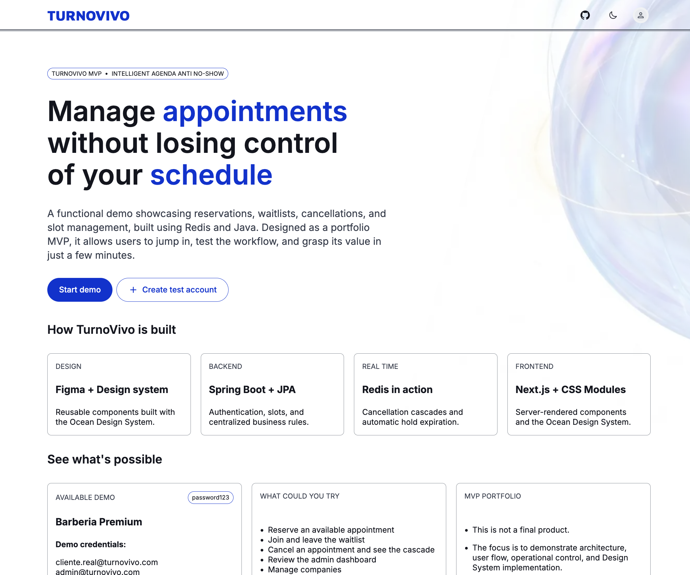
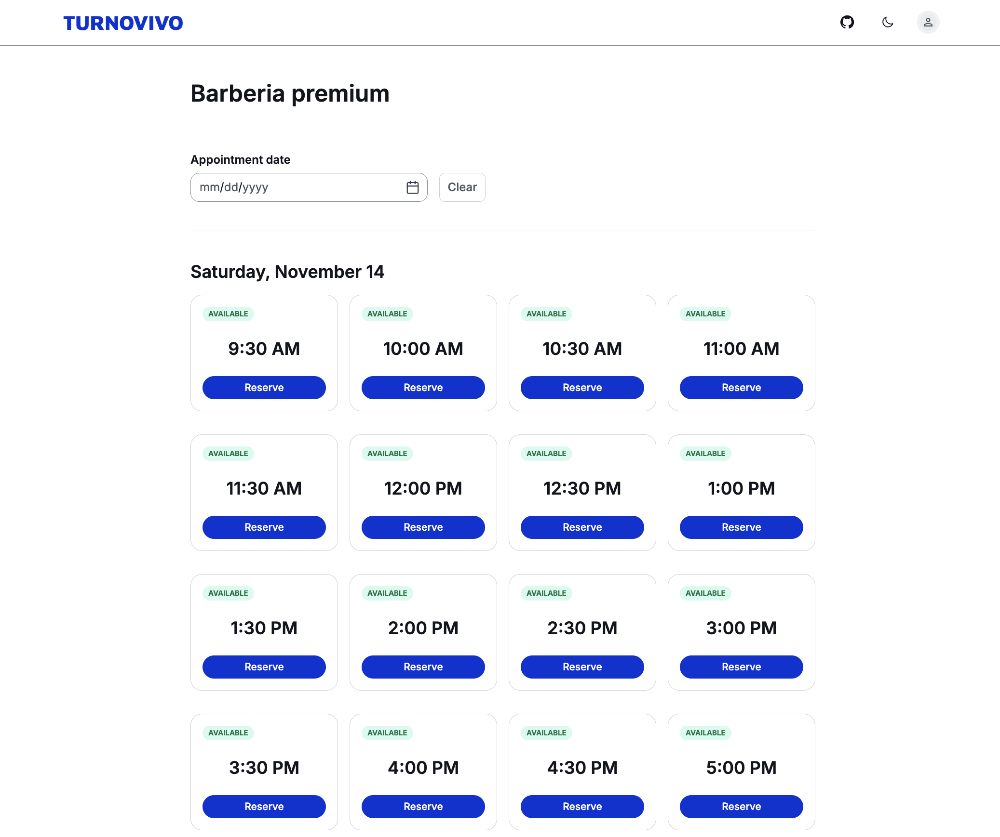
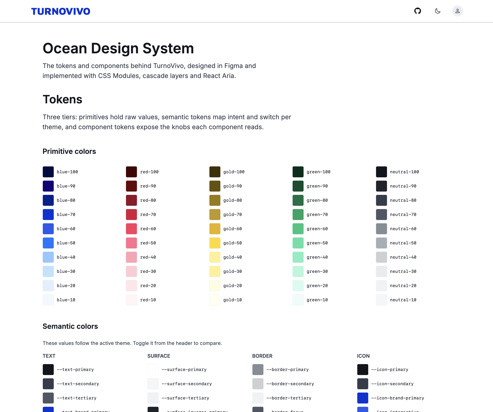
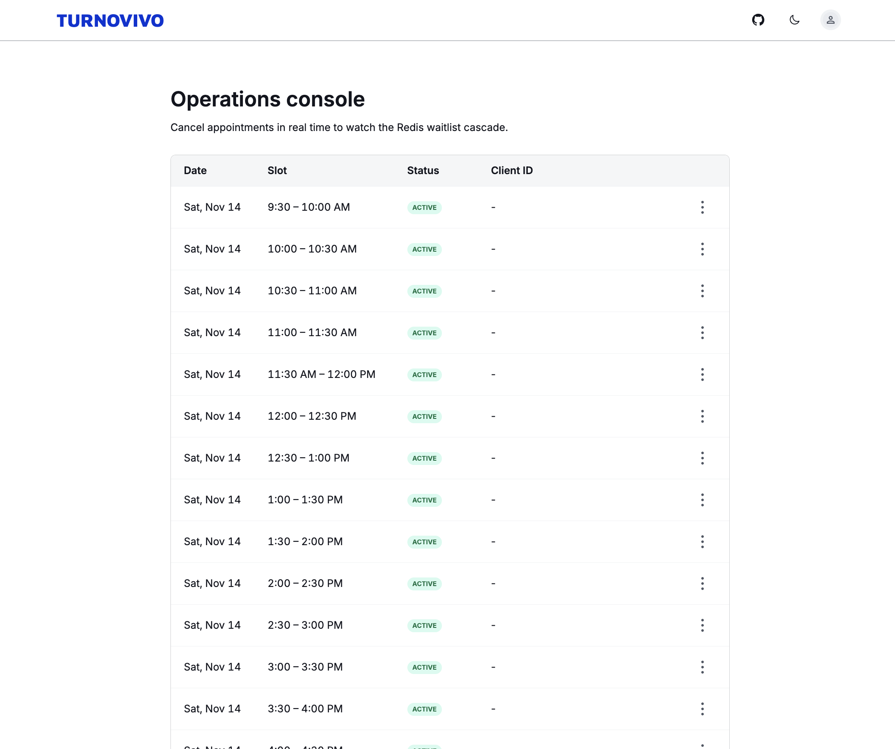

# TurnoVivo · Frontend

Real-time appointment booking with a smart waitlist, built on the **Ocean Design System** — a token-driven
component library I designed in Figma and implemented from scratch.

> Portfolio MVP. The goal is to show product thinking, a production-grade design system implementation and
> accessible, resilient UI states — not feature breadth.

**Live design system:** `/design-system` (public, no sign-in needed).

## Highlights

- **Design system from Figma to code** — three token tiers (primitive → semantic → component), CSS Modules,
  cascade layers (`ds.atoms < ds.molecules < ds.layouts`) so app styles override the DS predictably.
- **Accessibility built in** — React Aria primitives, visible focus, `forced-colors` support, reduced motion,
  semantic live regions, WCAG AA contrast verified in both themes, automated axe tests and `jsx-a11y` lint.
- **Resilient UI states** — every async action shows a spinner and locks until it settles (no double
  submissions), route-level loading and error boundaries, offline notice when polling fails, empty vs error
  states kept distinct.
- **Light and dark themes** — persisted choice applied before first paint (no flash), `color-scheme` aware.
- **Mobile first** — the full booking flow works on a phone, 44px touch targets on calendar days, buttons
  keep the DS sizes (48/40/32) with an invisible 48px touch area on compact ones, tables
  stack into cards under 640px, zero layout shift (CLS 0).
- **Race-condition safe** — one request per action in the UI, newer availability requests cancel older ones,
  and two customers booking the same slot at once were verified to produce exactly one winner.
- **Quality gates in CI** — ESLint, Stylelint token enforcement, type check, 270+ tests, production build.

Lighthouse (mobile, production build): performance 86–93, accessibility 100 on the booking page, the design
system page and the auth pages.

Search for `!\[|
  
</p>

| Booking agenda | Design system | Admin dashboard |
| --- | --- | --- |
|  |  |  |


## Stack

| Layer | Tools |
| --- | --- |
| Framework | Next.js 16 (App Router, Server Components), React 19, TypeScript strict |
| UI | React Aria Components, CSS Modules, design tokens as CSS custom properties |
| Testing | Vitest, Testing Library, axe-core |
| Quality | ESLint (Next + jsx-a11y recommended), Stylelint, GitHub Actions |
| Backend (separate repo) | Spring Boot, Spring Security + JWT, PostgreSQL, Redis |

## Design system

```
src/design-system/
├── tokens/        primitives · color aliases · typography · dimensions · effects · layout
│                  semantic-light · semantic-dark · component tokens
├── icons/         typed SVG registry
├── atoms/         Button · Input · Select · Badge · Avatar · Icon · Spinner · Divider
├── molecules/     Card · DatePicker · Table · Toast · ConfirmDialog · FormModal
└── layouts/       AuthLayout
```

Rules the codebase follows (and CI enforces):

- **No raw values outside `tokens/`.** Stylelint rejects hex colors, named colors, `rgb()/hsl()`, the units
  `px rem em ms s deg`, bare `transparent`, and numeric `z-index`, `opacity`, `font-weight` and `line-height`.
  Media queries may only use the breakpoint scale.
- **States come from React Aria data attributes** — `[data-hovered]`, `[data-pressed]`, `[data-disabled]`,
  `[data-pending]`, `[data-focus-visible]`.
- **Components expose CSS custom properties as their public styling API** (e.g. `--button-solid`,
  `--button-border-width`) instead of accepting arbitrary class overrides.
- **Async by default.** `Button` accepts an `onPress` that returns a promise; it locks itself and renders an
  accessible progress indicator until the promise settles. `lockOnPress` keeps navigation buttons locked.

```tsx
<Button onPress={() => api.book(slotId)} pendingLabel="Booking">Reserve</Button>
<Button iconOnly aria-label="Appointment actions"><Icon name="moreVertical" /></Button>
```

## Accessibility

- Keyboard support and focus management through React Aria (menus, dialogs, date picker, select).
- Dialogs trap and restore focus; destructive confirmations use `alertdialog`.
- Toasts: errors are `alert`, everything else `status`; polled lists do not spam screen readers.
- Contrast measured in the browser for every button variant and text element in both themes (WCAG AA).
- `prefers-reduced-motion` slows spinners instead of hiding progress; `forced-colors` keeps borders visible.
- Automated: `src/a11y.spec.tsx` runs axe against every component state, open dialogs, auth pages, the booking
  agenda and the admin table.

## Getting started

Requirements: Node.js 20+ and the TurnoVivo backend running on `http://localhost:3000`.

```bash
npm install
npm run dev:3001      # http://localhost:3001
```

Optional `.env.local`:

```bash
NEXT_PUBLIC_API_URL=http://localhost:3000
NEXT_PUBLIC_DEFAULT_BUSINESS_SLUG=barberia-premium
NEXT_PUBLIC_DEFAULT_BUSINESS_NAME="Barberia Premium"
NEXT_PUBLIC_REPOSITORY_URL=https://github.com/<user>/<repo>
NEXT_PUBLIC_BUSINESS_TIME_ZONE=America/Mexico_City   # IANA zone; must match the backend
NEXT_PUBLIC_APP_LOCALE=en-US                          # es-MX switches every date, time and duration
```

The design system showcase (`/design-system`) works without the backend.

### Demo accounts

Password for all: `password123`

| Role | Email | What to try |
| --- | --- | --- |
| Client | `cliente.real@turnovivo.com` | Book, join/leave the waitlist, cancel and watch the cascade |
| Client 2 | `cliente.real2@turnovivo.com` | Open a second browser and race client 1 for the same slot |
| Admin | `admin@turnovivo.com` | Force-cancel appointments from the operations console |
| Super admin | `super.admin@turnovivo.com` | Create, edit and deactivate companies and admins |

## Scripts

| Command | Purpose |
| --- | --- |
| `npm run dev:3001` | Development server on port 3001 |
| `npm run build` / `npm start` | Production build and server |
| `npm test` | Unit, integration and accessibility tests |
| `npm run lint` | ESLint with the full `jsx-a11y` recommended set |
| `npm run lint:css` | Stylelint token enforcement |
| `npm run typecheck` | TypeScript without emitting |

## Project structure

```
src/
├── app/
│   ├── (main)/          home · [slug] booking · admin · super-admin · design-system
│   │                    shared loading.tsx and error.tsx boundaries
│   └── (auth)/          login · register
├── components/          feature UI only (agenda, admin, super admin, header, showcase)
├── hooks/               data hooks: live slots polling, super-admin directory, clock
├── domain/              pure business rules: slots, dates/format, validation, access
├── services/
│   ├── http-client.ts   the only fetch: token, transport and HTTP errors, abort support
│   ├── api.ts           typed endpoints
│   ├── api-parsers.ts   validates every API response before the UI sees it
│   ├── session.ts       the only place that touches the token cookie
│   └── server-session.ts  guard for protected server pages
├── context/             auth, UI (toasts and confirm), theme
├── design-system/       see above
└── a11y.spec.tsx        axe suite
```

## Technical decisions

- **Layers:** UI components → hooks / domain rules → typed services → one HTTP client. Components never
  read the token or call `fetch`.
- **No blank screens:** responses are parsed as `unknown` and validated; malformed records are dropped,
  unusable responses become a typed `ApiError` and route error boundaries catch the rest.
- **Dates:** every date is shown and grouped in the business time zone with `Intl`, so server and browser
  render the same text; past days are disabled and slots that already started disappear.
- **Race conditions:** buttons lock while their request is pending, availability requests are aborted when a
  newer one starts, and late responses are ignored.

## Deployment

1. Set the `NEXT_PUBLIC_*` variables above for the deployed backend URL.
2. Allow the frontend origin in the backend CORS configuration; otherwise polling fails and the agenda shows
   the "Connection lost" notice.
3. Run the backend with the business time zone (for example `TZ=America/Mexico_City`): its clock uses the
   host zone, and cloud hosts default to UTC.

## Known limitations

- **Session token in a JavaScript-readable cookie.** The backend returns the JWT in the response body, so the
  client stores it with `js-cookie`. An XSS bug could read it; the production fix is an `HttpOnly`,
  `Secure`, `SameSite` cookie issued by the backend.
- **Past slots are guarded in the client only.** The backend hides started slots but does not reject booking
  one; the UI re-checks the exact time before sending.
- **Availability is not filtered by date on the server.** The agenda downloads the 14-day window and filters
  locally.

## Troubleshooting

- **Network error on login or agenda** — make sure the backend is running on port 3000.
- **"Connection lost" notice** — polling failed; the UI keeps the last known data and retries automatically.
  On a deployed frontend this usually means the backend CORS does not allow its origin.
- **Odd session state** — clear the `turnovivo_token` cookie and sign in again.
